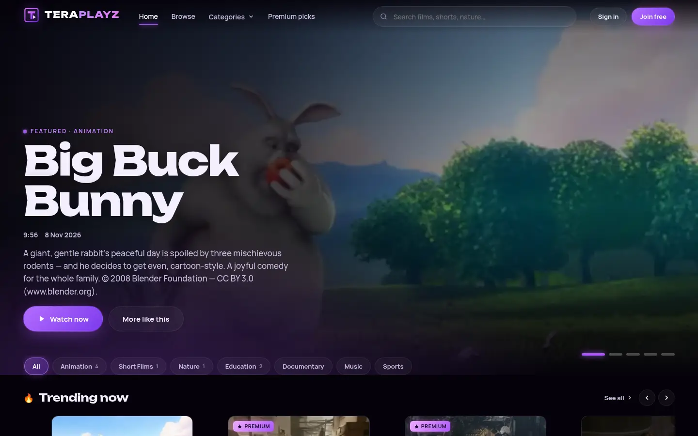
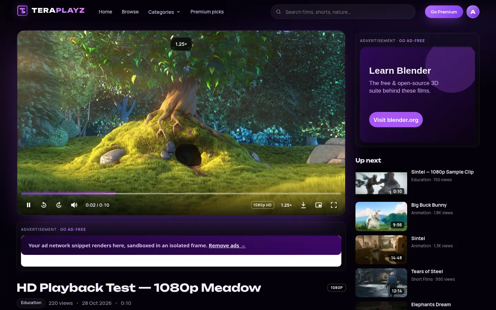
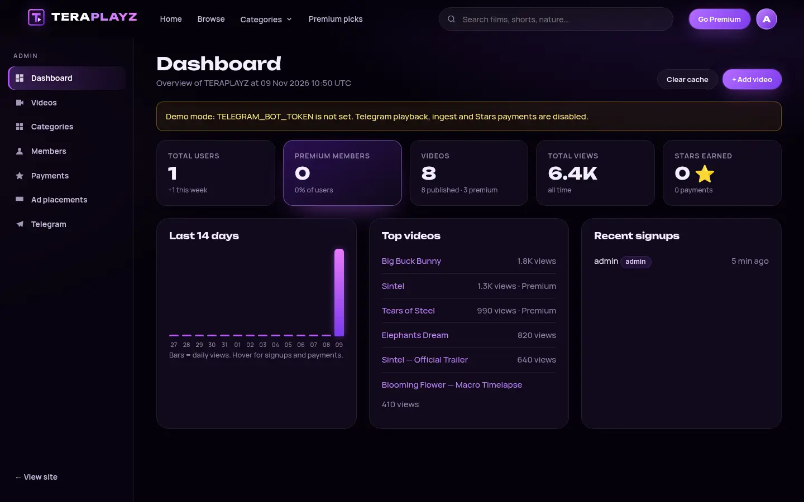
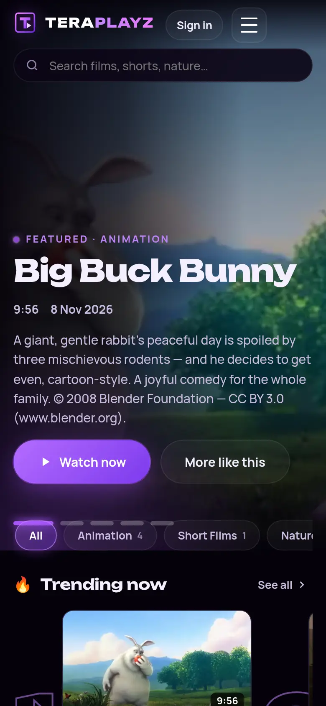

# TERAPLAYZ

**TERAPLAYZ** is a premium, dark, neon-violet video-streaming site for **general-audience, family-friendly content**.
Video files live in a **private Telegram channel** (official Bot API); the website stores only metadata,
proxies playback with HTTP Range, and sells an optional **Premium membership for 100 Telegram Stars / month**.
It is built to run on **Koyeb's free web service** (512 MB RAM, 0.1 vCPU).



| Watch page / custom player | Admin dashboard | Mobile |
|---|---|---|
|  |  |  |

---

## Features

**Public site**
- Glass navbar with original TERAPLAYZ SVG wordmark, live search suggestions, category menu, sign-in/join, Premium CTA / badge.
- Rotating featured hero, *Trending now* (views decayed by age), *Latest releases*, per-category rows, *Continue watching*.
- Browse/search page: title + description search, category chips and select, sort (latest / most viewed / A–Z / oldest),
  server-side `LIMIT/OFFSET` pagination **plus** "Load more" / infinite scroll (server-rendered partials), `loading="lazy"` images.
- Cards with thumbnail, title, category, upload date, views, duration, HD and Premium badges, hover glow, locked state.
- Empty states, 404/403/429 pages, skip link, focus rings, `prefers-reduced-motion`, responsive mobile → desktop.

**Custom HTML5 player** (`public/js/player.js`, no library)
- Play/pause, ±10 s, seek bar (mouse, touch, keyboard, hover time), volume + mute (remembered), playback speed 0.5–2×,
  fullscreen (incl. iOS fallback + landscape lock), Picture-in-Picture, buffering spinner, resolution/HD badge, Media Session.
- Keyboard: <kbd>Space</kbd>/<kbd>K</kbd>, <kbd>J</kbd>/<kbd>L</kbd>, arrows, <kbd>M</kbd>, <kbd>F</kbd>, <kbd>&lt;</kbd>/<kbd>&gt;</kbd>, <kbd>0–9</kbd>.
- **Resume playback**: localStorage for everyone + server-side `watch_progress` for signed-in users (synced every 15 s / on pause / on leave).
- **Download** button only when the video has *Allow downloads* **and** the signed-in user may watch it.
- Bytes are streamed by `/stream/:id` with `Range` forwarding and `stream.pipeline` (≈64 KB buffers) — the app never holds a whole file in memory.

**Accounts & security**
- Username + password (bcrypt cost 12), DB-backed sessions (cookie holds a random token; DB stores its HMAC), `HttpOnly`, `SameSite=Lax`, `Secure` + `__Host-` prefix in production.
- Roles `user` / `admin`, enforced server-side on every admin route (`router.use(requireAdmin)`).
- `ADMIN_USERNAME` / `ADMIN_PASSWORD` upserted on every start.
- CSRF: signed double-submit token (HMAC of an HttpOnly seed cookie) on **every** unsafe request + Origin check; multipart uploads are only accepted on the two video routes and verified after parsing.
- Helmet (strict CSP: `script-src 'self'`, no inline scripts), rate limits (global, login, register, search, API, stream, payments, webhook, admin), input validators, generic login errors with constant-time dummy hash, open-redirect-safe `?next=`.
- The bot token, `getFile` URLs and the private channel id are never sent to browsers or logged (`redact()`); verified by tests.

**Admin dashboard** (`/admin`)
- Stats: users, premium members, videos (published/premium), total views, Stars earned, 14-day views chart, top videos, recent signups, config warnings.
- Videos: list/filter (published, drafts, premium, *over Telegram limit*), add, edit, delete, publish/unpublish, featured, premium-only, downloads.
- **Retrieve from Telegram**: enter the channel message id → server forwards that post silently inside the channel, reads `file_id`, `file_unique_id`, size, duration, resolution, MIME and thumbnail, deletes the temporary copy and fills the form. Saving with only a message id does this automatically.
- Thumbnails: upload (compressed by `sharp` to 640×360 WebP ≈ 20–40 KB), image URL, or Telegram thumbnail `file_id` (proxied by `/thumb/:id`, cached 1 day).
- Categories CRUD, Members (search/filter, +days, set expiry date, revoke, suspend), Payments ledger, Ad placements CRUD, Telegram status + one-click `setWebhook`.

**Ads**
- Slots `home_top`, `home_mid`, `browse_top`, `watch_below`, `watch_sidebar`; page filter `all|home|browse|watch`; enable/disable; order.
- Image+link ads or raw **HTML snippets rendered in a sandboxed, opaque-origin iframe** (`/ads/frame/:id`, own CSP) so ad code can't read cookies, touch the page or overlay the player.
- Rendered only for guests and free users. Premium users get zero ad markup (and the frame endpoint returns 204 for them).

**Premium — Telegram Stars**
- 100 ⭐ (`XTR`) for **31 days** (a "month" is defined as 31 days, configurable). Each payment stacks from `max(now, current expiry)`.
- Status is computed from `premium_until` on every request — no cron, no worker. Cancellation turns off renewal reminders; paid time is always honoured.
- Full flow is implemented and tested against a Bot API mock (see *Telegram setup* below).

---

## Architecture

```
Browser ──HTTPS──► Koyeb edge ──► Node 22 / Express (this app, 1 process)
                                   ├─ EJS server-rendered pages + vanilla JS/CSS
                                   ├─ SQLite (better-sqlite3)  or  PostgreSQL (pg)  ← metadata, users, payments
                                   ├─ in-memory TTL cache (listings/categories, 60 s; ads 120 s)
                                   ├─ /stream/:id  ──pipe+Range──►  Telegram file server (api.telegram.org/file/bot…)
                                   │                               or a public CC sample URL (demo mode)
                                   └─ /telegram/webhook ◄── Telegram updates (payments, linking, channel posts)
```

- **Metadata vs files**: the `videos` table stores `telegram_message_id`, `telegram_file_id`, `telegram_file_unique_id`, thumb file id, size, duration, resolution, flags. Files never touch the app's disk.
- **Two dialects, one query layer** (`src/db/index.js`): SQL is written once with `?` placeholders (rewritten to `$n` for Postgres); helpers `all/get/run/tx`; timestamps are integer milliseconds in both engines.
- Schema: [`db/schema.sql`](db/schema.sql) (SQLite) and [`db/schema.postgres.sql`](db/schema.postgres.sql) (PostgreSQL), applied idempotently at startup.

Tables: `users`, `sessions`, `categories`, `videos`, `watch_progress`, `telegram_link_tokens`, `invoices`, `payments`, `ads`, `daily_stats`, `thumbnails`, `settings`.

### Project structure

```
teraplayz/
├── server.js                  # entry: init DB → bootstrap (admin/demo seed) → listen
├── package.json / package-lock.json
├── Dockerfile / .dockerignore / .env.example / .gitignore
├── db/schema.sql, db/schema.postgres.sql
├── src/
│   ├── app.js                 # express app, helmet/CSP, static, healthz, middleware order, errors
│   ├── config.js              # env parsing (+ tiny .env loader)
│   ├── db/index.js            # portable SQLite/Postgres helper
│   ├── cache.js  util.js  validators.js  seed.js  telegram.js
│   ├── middleware/            # session.js csrf.js flash.js rateLimits.js
│   ├── services/              # videos.js membership.js ads.js stats.js thumbs.js
│   └── routes/                # public.js watch.js auth.js premium.js webhook.js admin.js
├── views/                     # EJS pages, partials/, admin/, errors/
├── public/                    # css/app.css css/admin.css js/app.js js/player.js js/premium.js js/admin.js img/
├── scripts/                   # seed.js set-webhook.js pg-smoke.js
├── test/                      # e2e.demo.test.js e2e.telegram.test.js helpers.js
├── docs/screenshots/
└── data/.gitkeep              # SQLite DB + disk thumbnails (git-ignored)
```

Runtime dependencies (10): `express`, `ejs`, `better-sqlite3`, `pg`, `bcryptjs`, `helmet`, `express-rate-limit`, `multer`, `sharp`, `compression`. No front-end framework, no Redis, no workers.

---

## Run locally

Requires **Node.js 22+** (Node 20 is end-of-life since 30 Apr 2026 and `better-sqlite3` 13 requires 22).

```bash
cd teraplayz
npm ci            # .npmrc sets ignore-scripts: native deps use bundled prebuilds, no compiler needed
cp .env.example .env
# edit .env: NODE_ENV=development, SESSION_SECRET=<random 32+ chars>, ADMIN_PASSWORD=<strong>, COOKIE_SECURE=false
npm start            # or: npm run dev (auto-restart)
open http://localhost:3000        # admin: http://localhost:3000/admin
```

With no `TELEGRAM_BOT_TOKEN` the site runs in **DEMO mode**: it seeds Creative Commons films (Big Buck Bunny, Elephants Dream,
Sintel, Tears of Steel — © Blender Foundation, CC BY — plus CC0 sample footage) using public HTTPS MP4 URLs that are still
proxied through `/stream/:id`, so gating, Range and the player behave exactly like Telegram videos. Payments are disabled and the Premium CTA explains why; admins can grant Premium manually.

Key variables: see [`.env.example`](.env.example) (every variable documented).

| Variable | Purpose |
|---|---|
| `SESSION_SECRET` | **required in production**, 32+ random chars (sessions, CSRF) |
| `ADMIN_USERNAME`, `ADMIN_PASSWORD` | admin account upserted at startup |
| `DATABASE_URL` | use PostgreSQL; otherwise SQLite at `DATABASE_PATH` / `DATA_DIR` |
| `TELEGRAM_BOT_TOKEN`, `TELEGRAM_CHANNEL_ID`, `TELEGRAM_WEBHOOK_SECRET`, `PUBLIC_BASE_URL` | Telegram library + Stars |
| `TELEGRAM_API_ROOT`, `TELEGRAM_MAX_FILE_MB` | self-hosted Bot API server / size limit |
| `PREMIUM_PRICE_STARS` (100), `PREMIUM_PERIOD_DAYS` (31) | membership |
| `THUMB_STORAGE` | `db` (default with Postgres) or `disk` |

### Tests

```bash
npm test                                   # 26 end-to-end tests (spawns the real server)
node scripts/pg-smoke.js postgres://…      # same main flows against PostgreSQL
```

- `test/e2e.demo.test.js` (17 tests, demo mode, SQLite): `/healthz`, homepage sections + ads + CSP, search & empty state,
  category filter + pagination partials, player page controls, Range streaming (206) without exposing the upstream URL,
  premium gating for guests/free users (page + stream 403), register/login, download rules, bad credentials / duplicate /
  weak password, CSRF (missing, forged, cross-origin), admin-only access (302/403), video create with thumbnail upload →
  WebP 640×360, edit, unpublish hides (search, watch 404, stream 404; admin preview OK), publish, validation, delete,
  categories CRUD, admin premium grant → no ads + badge + premium stream, expiry computed live, revoke, resume API,
  ad toggling/creation, demo-mode Stars CTA, logout. *Needs internet (proxies public CC sample files).*
- `test/e2e.telegram.test.js` (9 tests) runs the app against a **local mock of the Bot API** (`TELEGRAM_API_ROOT`):
  webhook secret enforcement, channel-post auto-ingest as draft (+ dedupe, foreign chats ignored), *Retrieve from Telegram*
  (forward + cleanup), create-from-message-id, proxied Telegram playback with Range and full download, Telegram thumbnail
  proxy, **token/channel never in HTML, headers or logs**, 20 MB limit → 413 + admin warnings, full **Stars** flow
  (link via `/start link_…`, single-use token, `createInvoiceLink` + `sendInvoice` in XTR/100, pre-checkout rejects wrong
  amount/payer/unknown payload, payment grants exactly 31 days, **replayed charge id ignored**, paid invoice can't be reused,
  renewal stacks +31 days, cancel keeps expiry), non-XTR/under-priced payments rejected, admin forward-to-bot ingest, `setWebhook` with `secret_token`.

---

## Telegram setup (private channel library + Stars)

1. **Create the bot** – in Telegram open **@BotFather** → `/newbot` → copy the token into `TELEGRAM_BOT_TOKEN` (keep it secret) and the username into `TELEGRAM_BOT_USERNAME`.
2. **Create a private channel** – New Channel → *Private*. This is your video library.
3. **Add the bot as channel admin** with *Post messages* and *Delete messages* rights (needed for auto-ingest and *Retrieve from Telegram*, which forwards a post into the same channel and immediately deletes the copy, because the Bot API has no "get message" method).
4. **Get the channel id** – post anything in the channel, open `https://t.me/c/<number>/<msg>` from *Copy post link*: the channel id is `-100<number>` (e.g. link `t.me/c/1234567890/5` → `TELEGRAM_CHANNEL_ID=-1001234567890`). Alternatively forward a channel post to @username_to_id_bot-style tools or read `channel_post.chat.id` from the webhook log.
5. **Pick a webhook secret** – `TELEGRAM_WEBHOOK_SECRET` = 16–256 chars of `A-Z a-z 0-9 _ -`.
6. Set `PUBLIC_BASE_URL` (your https URL), deploy, then register the webhook: **Admin → Telegram → Register webhook**, or `npm run telegram:webhook` (also sets bot commands). Check with `npm run telegram:webhook:info`. Telegram then POSTs to `/telegram/webhook` with header `X-Telegram-Bot-Api-Secret-Token`; anything else gets 401.
7. **Add videos** (≤ 20 MB each on the cloud Bot API — see limits):
   - post the video in the channel → it appears as a **draft** in *Admin → Videos* (caption line 1 = title, rest = description); or
   - forward/send a video to the bot from a Telegram account linked to an **admin** site account; or
   - *Add video* → enter the **message id** → *Retrieve from Telegram*.
   Then set category/thumbnail/flags and **Publish**.

**Telegram Stars** need no payment provider: digital goods in bots are sold in Stars (`currency: "XTR"`, no `provider_token`).
Flow implemented in `src/routes/premium.js`, `src/routes/webhook.js`, `src/services/membership.js`:

1. Signed-in user opens **/premium** → *Link Telegram* → one-time deep link `t.me/<bot>?start=link_<token>` (30 min, single use) binds their `telegram_id`.
2. *Go Premium* → server creates an `invoices` row with an opaque random payload bound to the user, calls `createInvoiceLink` (button in the page) **and** `sendInvoice` (in the bot chat). `/premium` in the bot does the same.
3. `pre_checkout_query` → server checks currency `XTR`, amount `100`, payload exists, is pending, < 48 h old, user not banned and payer = linked Telegram user → `answerPreCheckoutQuery`.
4. `successful_payment` (only ever from the authenticated webhook) → inside a DB transaction: reject if the `telegram_payment_charge_id` was already stored (replay), store the charge, extend `premium_until`, mark invoice paid. The page polls `/api/premium/status` and reloads when the server sees the new expiry. **Nothing the browser sends can grant Premium.**
5. Renewal = pay again (time stacks). Cancel = stop reminders (a banner appears 3 days before expiry for users who haven't cancelled). Refunds are not automated in the UI: call the Bot API `refundStarPayment` with the user id + charge id shown in *Admin → Payments*, then revoke/adjust in *Members*. Bot implements `/paysupport` (set `SUPPORT_CONTACT`) as Telegram requires for payment bots.

---

## Docker

```bash
docker build -t teraplayz .
# COOKIE_SECURE=false only for testing over plain http://localhost — omit it behind HTTPS
docker run -d --name teraplayz -p 3000:3000 \
  -e NODE_ENV=production -e SESSION_SECRET="$(openssl rand -hex 32)" \
  -e ADMIN_USERNAME=admin -e ADMIN_PASSWORD='a-long-unique-password' \
  -e COOKIE_SECURE=false \
  -v teraplayz-data:/app/data \
  teraplayz
curl localhost:3000/healthz          # {"status":"ok","uptime":…}
```

Image: `node:22-alpine`, multi-stage, `npm ci --omit=dev`, runs as non-root `node`, `tini` as PID 1, `HEALTHCHECK` on `/healthz`, `NODE_OPTIONS=--max-old-space-size=256`, data dir `/app/data`.

---

## Deploy on Koyeb

> **Persistence on the free instance:** Koyeb Free instances (512 MB, 0.1 vCPU, 2 GB disk, Frankfurt or Washington only) **cannot attach Volumes** and their disk is wiped on every redeploy/restart/scale-to-zero. So on Free you **must set `DATABASE_URL`** to a managed PostgreSQL (e.g. **Neon** free tier, or Koyeb's managed Postgres — note Koyeb's free Postgres is limited to ~5 h active time/month). With `DATABASE_URL` set, uploaded thumbnails are stored in Postgres too (`THUMB_STORAGE=db`), so nothing important lives on the instance disk. On a paid instance you may instead keep SQLite by attaching a Volume at `/app/data` (Volumes: 1 instance only, preview feature — keep backups).

### Option A — from GitHub (Dockerfile builder)

1. Push this folder to a GitHub repo (the `.gitignore` keeps `.env`/data out).
2. Koyeb → **Create Web Service** → GitHub → repo → **Builder: Dockerfile**.
3. **Instance**: Free (or Eco/Nano+ for real traffic). **Region**: Frankfurt or Washington.
4. **Port** `3000` (HTTP), route `/` → 3000. **Health check**: HTTP, port 3000, path **`/healthz`**.
5. **Environment** (store sensitive values as Koyeb *Secrets*): `NODE_ENV=production`, `SESSION_SECRET`, `ADMIN_USERNAME`, `ADMIN_PASSWORD`,
   `DATABASE_URL`, `PUBLIC_BASE_URL=https://<app>-<org>.koyeb.app`, `TELEGRAM_BOT_TOKEN`, `TELEGRAM_CHANNEL_ID`, `TELEGRAM_WEBHOOK_SECRET`, optionally `TELEGRAM_BOT_USERNAME`, `SUPPORT_CONTACT`.
6. Deploy, open `/admin`, then *Admin → Telegram → Register webhook*.

### Option B — Koyeb CLI

```bash
koyeb app init teraplayz \
  --git github.com/<you>/teraplayz --git-branch main --git-builder docker \
  --instance-type free --regions fra \
  --ports 3000:http --routes /:3000 --checks 3000:http:/healthz \
  --env NODE_ENV=production \
  --env SESSION_SECRET='{{secret.teraplayz-session-secret}}' \
  --env ADMIN_USERNAME=admin --env ADMIN_PASSWORD='{{secret.teraplayz-admin-password}}' \
  --env DATABASE_URL='{{secret.teraplayz-database-url}}' \
  --env PUBLIC_BASE_URL=https://teraplayz-<org>.koyeb.app \
  --env TELEGRAM_BOT_TOKEN='{{secret.teraplayz-bot-token}}' \
  --env TELEGRAM_CHANNEL_ID='{{secret.teraplayz-channel-id}}' \
  --env TELEGRAM_WEBHOOK_SECRET='{{secret.teraplayz-webhook-secret}}'
# create the secrets first: koyeb secret create teraplayz-session-secret --value "…"
```

Or push the Docker image to a registry and use `--docker <registry>/teraplayz:latest` instead of `--git…`. Start command: `node server.js` (`npm start`).

### `/healthz`

`GET /healthz` → `200 {"status":"ok","uptime":N}` with no auth, no session, no DB query, `Cache-Control: no-store` — it answers as long as the process is up (registered before every other middleware, including rate limiting). `GET /healthz?deep=1` additionally runs `SELECT 1` and reports `"db":"ok"|"error"` (still HTTP 200) for manual diagnostics; don't point the platform check at the deep variant.

---

## Limitations — please read

**Telegram Bot API**
- The cloud Bot API **`getFile` only serves files up to 20 MB**. Larger videos are stored as drafts with a warning, flagged in the admin list ("too large"), and playback/download returns **413** with a clear admin-facing message. For bigger files run a **self-hosted [Telegram Bot API server](https://github.com/tdlib/telegram-bot-api)** (up to 2000 MB) and set `TELEGRAM_API_ROOT` (limit switches to 2000 MB automatically, or set `TELEGRAM_MAX_FILE_MB`) — no code change needed. That server is a separate always-on service and cannot run on the Koyeb free instance.
- 20 MB ≈ 2–4 minutes of 720p H.264: realistic catalogue items on the cloud API are short clips/trailers. Encode as **progressive MP4 (H.264/AAC, `+faststart`)** so browsers can start before the end of the file.
- Whether `api.telegram.org/file/…` honours `Range` is up to Telegram; the proxy forwards it and passes `206` through when available, otherwise it streams `200` and seeking is limited to what's buffered.
- Bot API flood limits apply (`getFile` is cached for 50 min per file_id, `getMe` per process). Every viewer's bytes go Telegram → your instance → viewer, so bandwidth is consumed twice on the instance.
- Telegram Stars are one-off invoices here (no automatic charging). Bot API also offers Stars *subscriptions* (`subscription_period` on `createInvoiceLink`); switching to them is possible but not implemented.

**Koyeb free instance**
- 0.1 vCPU / 512 MB is enough for the app (~140–150 MB RSS measured while proxying three concurrent full-length streams; memory stayed flat) but **not for heavy video streaming or unlimited traffic**: CPU for TLS + proxying, egress bandwidth, and concurrent connections are the bottleneck. Expect a handful of simultaneous viewers.
- **Scale-to-zero after 1 h idle** (cannot be disabled on Free) → first request pays a cold start; in-memory caches and rate-limit counters reset.
- **No volumes, ephemeral disk** → use `DATABASE_URL`. SQLite on Free = data loss on every restart.
- There is **no CDN** in front of `/stream`; responses are `private, no-store` on purpose (premium content must not be cached publicly). For growth: a larger instance (or several behind Koyeb autoscaling with Postgres), host public/free videos on object storage + CDN (Cloudflare R2/Bunny/BackBlaze + CDN) with signed URLs, and keep Telegram for the long tail. Static assets/thumbnails already send long-lived `Cache-Control`, so a CDN in front of the site helps those immediately.
- Rate limiter and caches are per-process memory; with multiple instances use a shared store (Redis) — not needed for one instance.

**Other**
- Demo-mode samples are hot-linked from archive.org / download.blender.org / test-videos.co.uk / MDN; if those hosts throttle, demo playback can stall (production uses Telegram).
- HTML ad snippets run in a sandboxed iframe: networks that need same-origin access or `document.write` into the top page won't work (intentional).

---

## Content policy

TERAPLAYZ is for **general-audience, age-appropriate content only**. Admins are responsible for only publishing material they have the rights to distribute. Demo films: *Big Buck Bunny*, *Elephants Dream*, *Sintel*, *Tears of Steel* © Blender Foundation / Orange OMP — CC BY 3.0 (https://www.blender.org); flower clip — CC0 (MDN sample media).
